# CHKOSDA LED Wall Clock — ESP32 IR Controller

MicroPython firmware for an ESP32 infrared dongle that automates countdown timers on 6-inch **CHKOSDA** digital LED wall clocks (`0xCC1D` NEC protocol) over a local web interface.

Programming a countdown on this clock with the stock 36-key membrane remote takes 11 button presses (`CD SET` ×2, `MODE` ×4, digits, `PLAY`), and a single missed IR pulse shifts your minute digits into the hours or days register. This project replaces the remote with a single-tap mobile web console hosted directly on an ESP32.

---

## Hardware & Pinout

| Component | ESP32 Pin | Notes |
| :--- | :--- | :--- |
| **IR LED (940 nm) + NPN Driver** | `GPIO 4` | Driven via 1 kΩ base resistor into a 2N2222 / BC547 switching 5V (`VIN`) through a 47–100 Ω current-limiting resistor. |
| **IR Receiver (VS1838B)** *(optional)* | `GPIO 14` | Used only during initial remote sniffing (`3.3V`, `GND`, `OUT -> GPIO 14`). |

```text
               +5V (ESP32 VIN)
                 |
                 +---[ 47-100 Ω ]---+
                                    |
                                 [Anode +]
                                 (940nm IR LED)
                                 [Cathode -]
                                    |
ESP32                               | Collector (C)
  GPIO 4 -------[ 1 kΩ ]--------- Base (B)   [NPN 2N2222 / BC547]
                                    | Emitter (E)
  GND ------------------------------+--- GND
```

### Reference Hardware & Manual

| Stock 36-Key Remote | User Manual (Page 1) | User Manual (Page 2) |
| :---: | :---: | :---: |
| 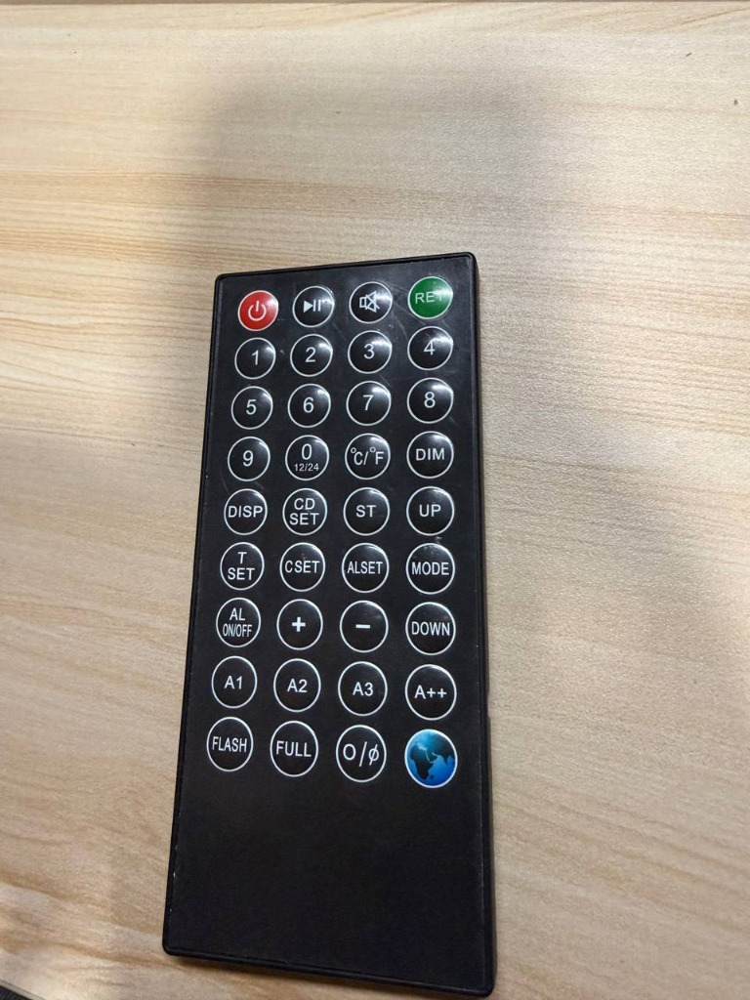 | 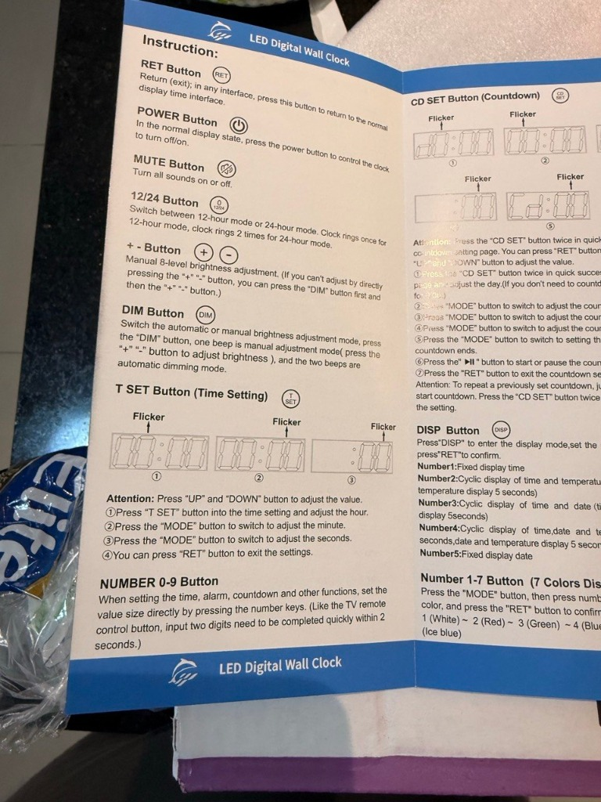 | 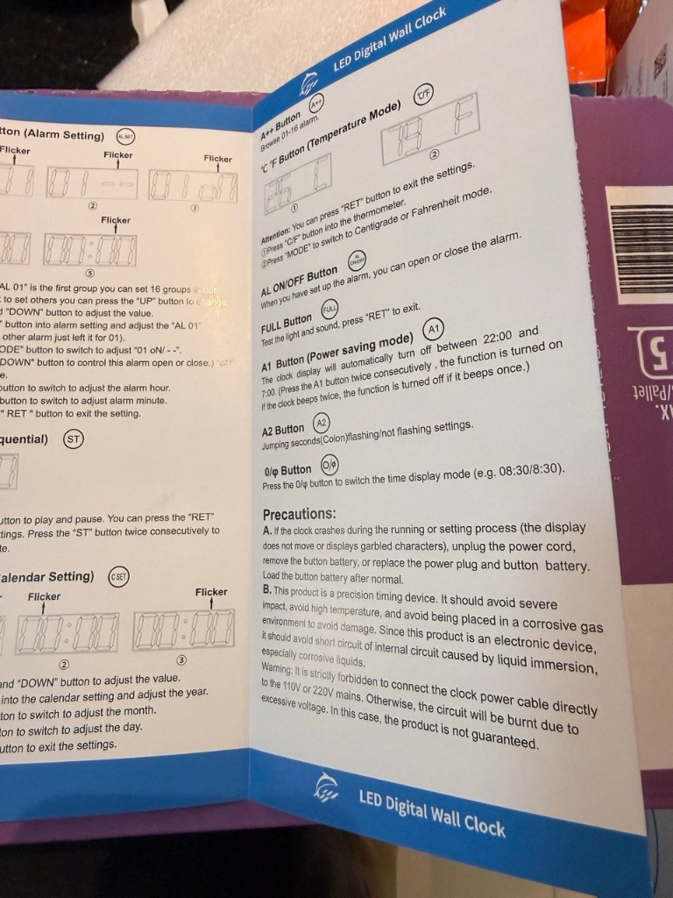 |

---

## NEC IR Code Map (`0xCC1D`)

All 36 keys were captured from the stock remote using a VS1838B receiver. Each 32-bit value is transmitted as 4 bytes (`[0xCC, 0x1D, cmd, ~cmd]`), **LSB-first per byte** over a 38 kHz carrier:

```python
CODES = {
    'POWER': 0xCC1D00FF,  'PLAY1': 0xCC1D21DE,  'MUTE':  0xCC1D22DD,  'RET':   0xCC1D01FE,
    '1':     0xCC1D11EE,  '2':     0xCC1D12ED,  '3':     0xCC1D13EC,  '4':     0xCC1D14EB,
    '5':     0xCC1D15EA,  '6':     0xCC1D16E9,  '7':     0xCC1D17E8,  '8':     0xCC1D18E7,
    '9':     0xCC1D19E6,  '0':     0xCC1D10EF,  'C_F':   0xCC1D1BE4,  'DIM':   0xCC1D1AE5,
    'DISP':  0xCC1D09F6,  'CD_SET':0xCC1D08F7,  'ST':    0xCC1D06F9,  'UP':    0xCC1D03FC,
    'T_SET': 0xCC1D07F8,  'CSET':  0xCC1D02FD,  'ALSET': 0xCC1D05FA,  'MODE':  0xCC1D04FB,
    'AL_ON': 0xCC1D20DF,  '+':     0xCC1D29D6,  '-':     0xCC1D2AD5,  'DOWN':  0xCC1D0AF5,
    'A1':    0xCC1D24DB,  'A2':    0xCC1D25DA,  'A3':    0xCC1D26D9,  'A++':   0xCC1D2BD4,
    'FLASH': 0xCC1D23DC,  'FULL':  0xCC1D27D8,  'SOUND': 0xCC1D28D7,  'PLAY2': 0xCC1D40BF
}
```

---

## Why Setting "1 Minute" Initially Set 1 Hour (`59:59`) or 24 Hours (`23:58`)

During initial testing, triggering a 1-minute countdown (`01:00`) consistently caused the clock to start counting down from **`59:59`** (1 hour) or **`23:58`** (24 hours).

| Clock starting at `59:59` instead of `00:59` | `01` written into the Hours register (`01:00`) |
| :---: | :---: |
| 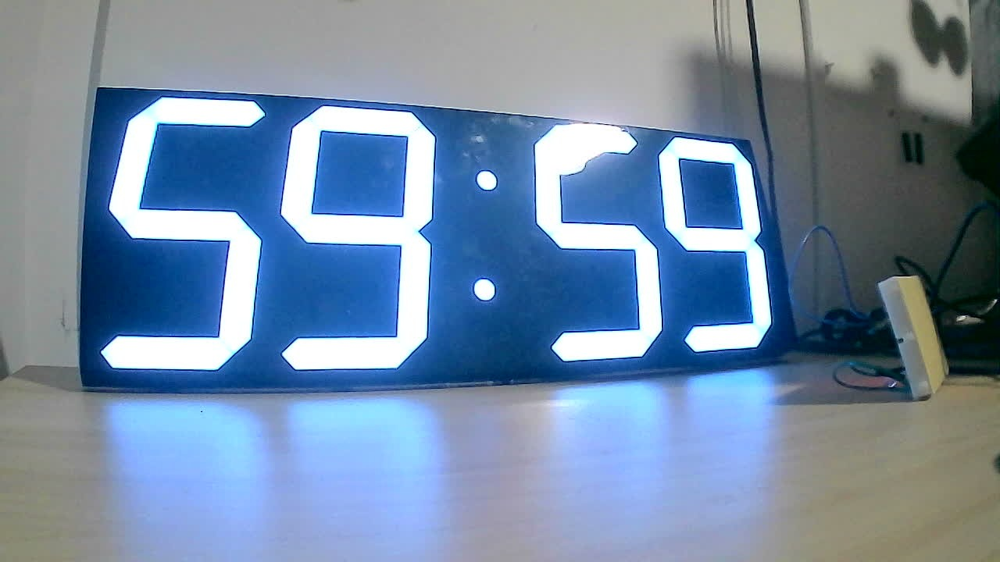 | 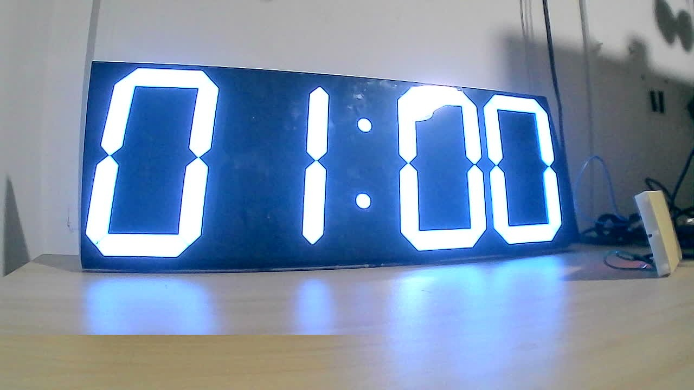 |

Capturing a webcam frame after every single IR command revealed three undocumented behaviors in the CHKOSDA microcontroller:

1. **`CD SET` ×2 Recalls EEPROM, It Does Not Zero the Registers:**
   Pressing `CD SET` twice loads whatever Days, Hours, Minutes, and Seconds were left in EEPROM from the previous countdown. If Hours or Days is non-zero from an earlier run, skipping those fields leaves the old values active.
2. **The Days Register (`d 000`) is 3 Digits Wide (`000`–`999`), Not 2:**
   Hours (`00`), Minutes (`00`), and Seconds (`00`) take 2 digits, but Days takes **3 digits**.
3. **The 2-Second Numeric Input Lockout:**
   A note in the manual under **NUMBER 0-9 Button** states:
   > *"Like the TV remote control button, input two digits need to be completed quickly within 2 seconds."*

   When you send digits to any field (e.g., typing `0`, `0` into Days or Hours), the clock opens a **2.0-second input window** waiting for additional digits. **While that 2-second window is open, the clock completely ignores the `MODE` button.**
   Because our early script sent `0`, `0` into Days and then sent `MODE` 350 ms later:
   - `MODE` was ignored because the clock was still waiting for the 3rd digit of Days.
   - The next `0`, `0` (intended for Hours) completed the 3rd digit of Days.
   - The next `MODE` (intended for Minutes) actually moved the cursor into **Hours**.
   - The `0`, `1` (intended for 1 Minute) was written directly into the **Hours** register (`01:00:00`), which immediately ticked down to `59:59` on `PLAY`.

### The 4 Countdown Setup Screens

| 1. Days (`d 000`) | 2. Hours (`00:00` left) | 3. Minutes (`00:00` right) | 4. Seconds (`:00`) |
| :---: | :---: | :---: | :---: |
| 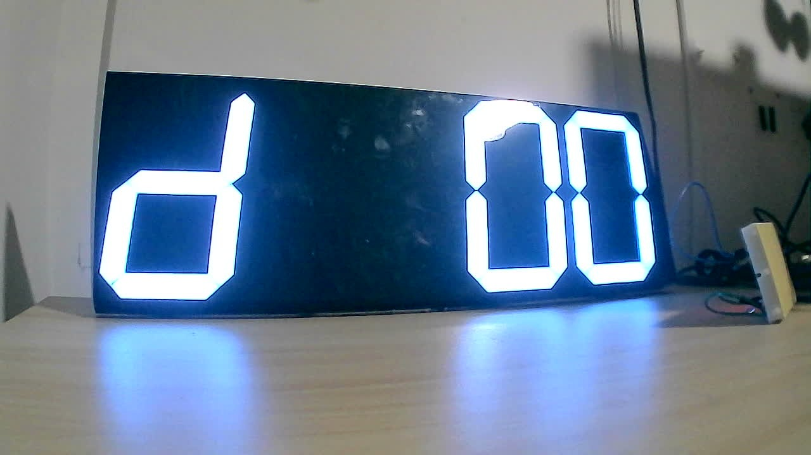 | 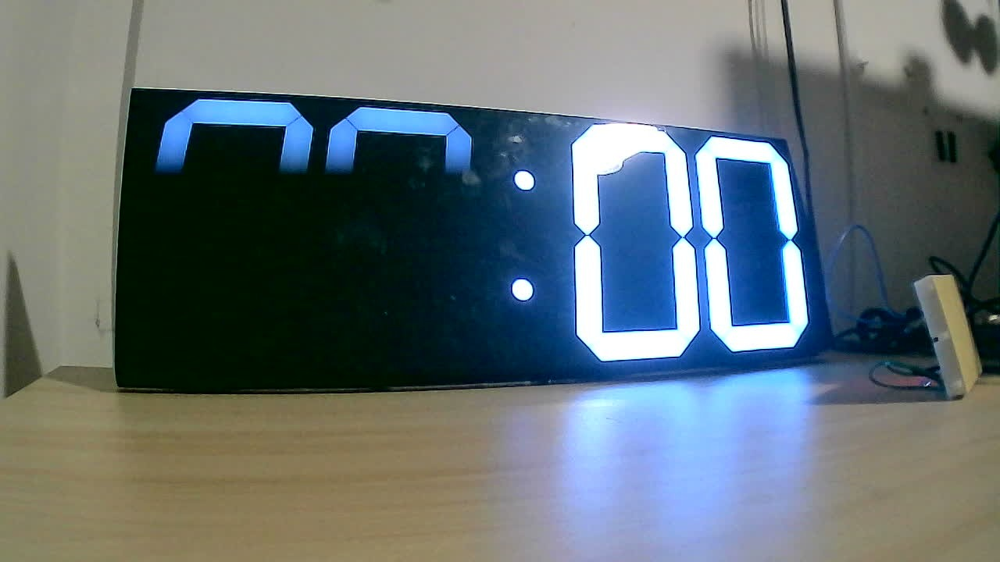 | 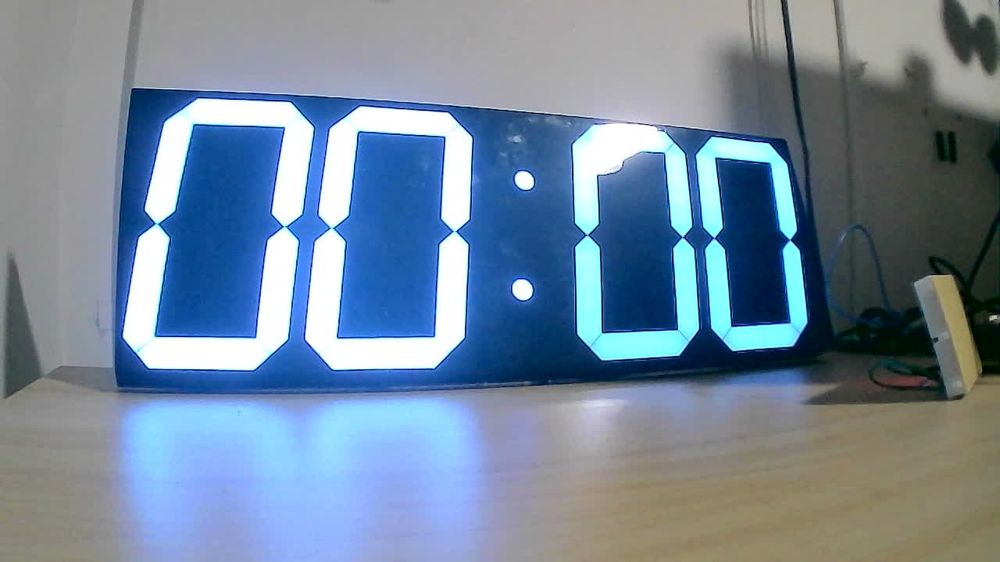 | 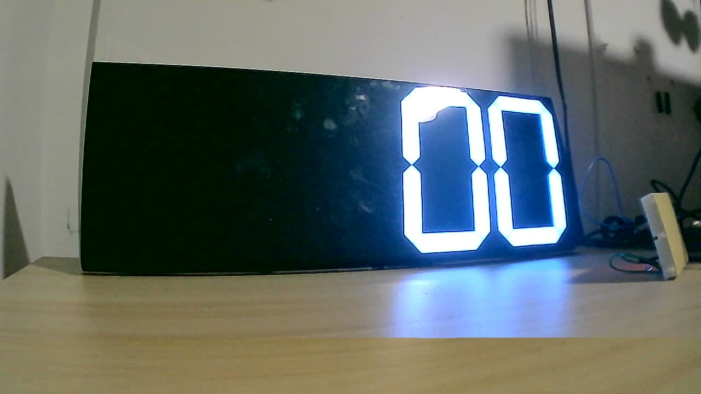 |

### Deterministic Timing Sequence

Waiting `2100 ms` after typing the digits for each field lets the clock's 2-second input window close before sending the next `MODE` command:

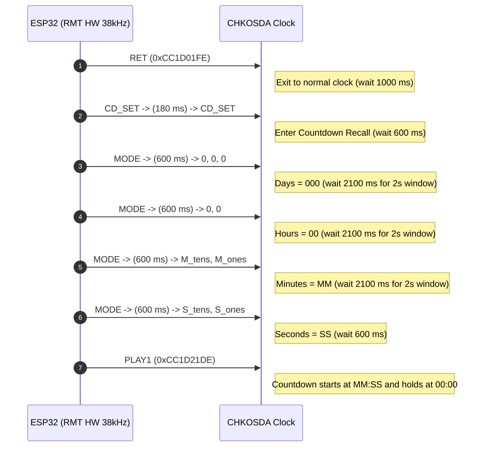

### Verified Results

| Normal Time (`02:44`) | 1-Minute Timer (`00:51`) | 3-Minute Timer (`02:54`) | Hold at `00:00` on Finish |
| :---: | :---: | :---: | :---: |
| 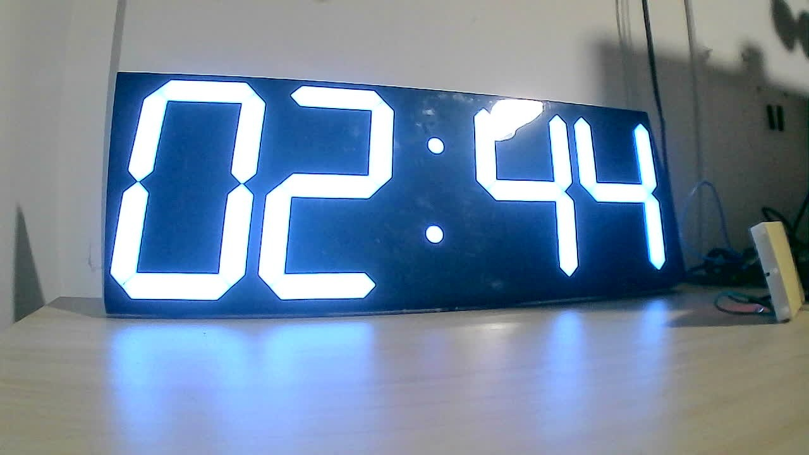 | 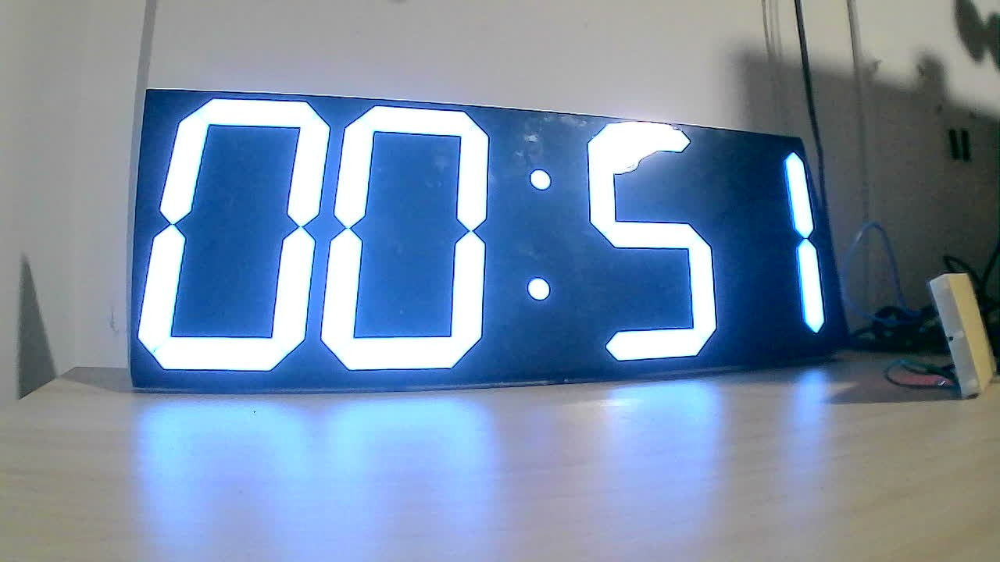 | 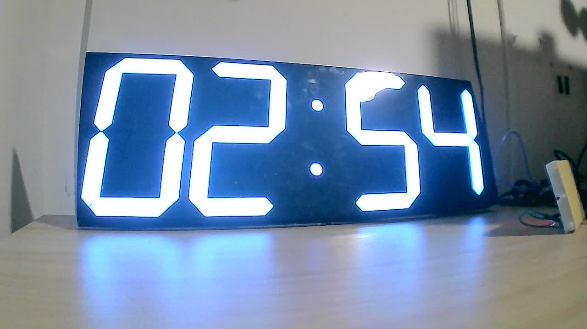 | 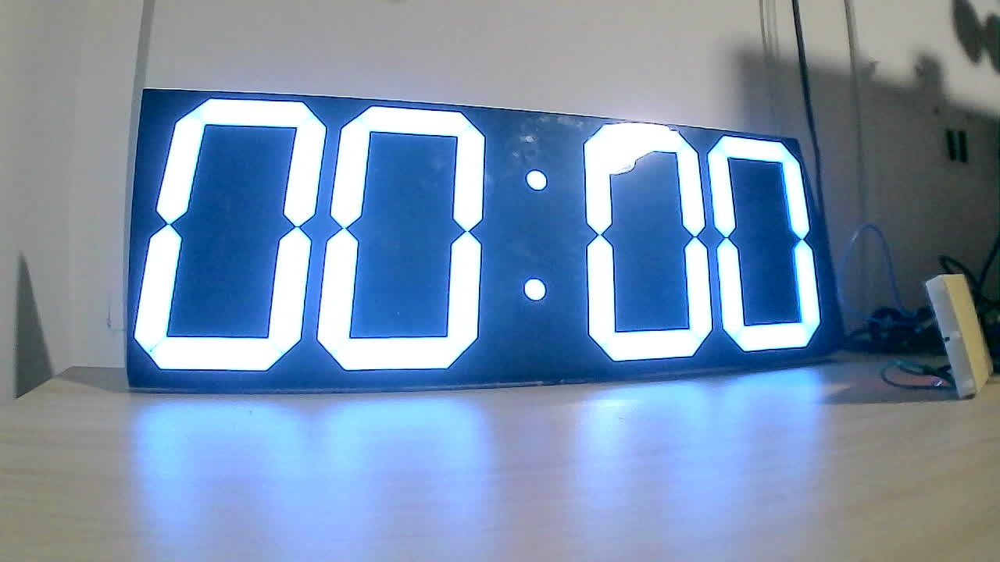 |

---

## ESP32 Runtime Fixes

1. **Hardware RMT Carrier (`67` vs. `2,012` Pulses):**
   Bit-banging the 38 kHz carrier in software produced a 2,012-element pulse list per NEC frame. Calling `rmt.write_pulses()` with 2,012 elements inside a `_thread` while the Wi-Fi station was active triggered a FreeRTOS stack overflow (`rst:ets Jul 29 2019`). Switching to hardware carrier modulation:
   ```python
   rmt = esp32.RMT(0, pin=pin, clock_div=80, tx_carrier=(38000, 33, 1))
   ```
   shrinks each NEC frame to **67 integers** (`[9000, 4500, 560, 560/1690, ..., 560]`) and runs synchronously on the main thread right after `cl.close()`.
2. **GPIO 4 RMT Pin Matrix Conflict:**
   Instantiating `machine.Pin(4, machine.Pin.OUT)` in `main.py` *after* `import web_app` (which imports `ir_tx` and binds `esp32.RMT` to `Pin(4)`) silently detached the RMT peripheral from the GPIO matrix. `ir_tx.py` now owns `Pin(4)` exclusively.
3. **Mobile Browser Socket Errors (`null error domain` / `connection closed`):**
   Fixed by computing `Content-Length` on the UTF-8 byte buffer (`len(raw)`) rather than the Unicode string length (`len(body)`), sending in 1024-byte chunks, and avoiding keyword arguments in MicroPython's `bytes.decode()`.
4. **Wi-Fi Scanner Empty Results (`[]`):**
   ESP-IDF's `sta.scan()` returns `[]` if the station interface is mid-connection. `wifi_mgr.scan_networks()` calls `sta.disconnect()` and waits `600 ms` before scanning.

---

## Wi-Fi Provisioning & Web Console

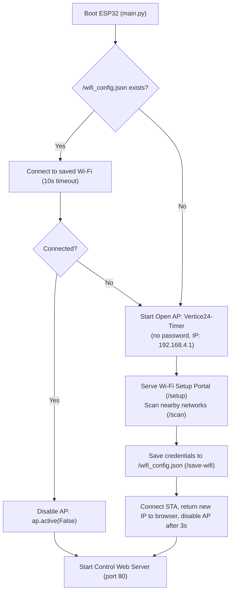

- **First Boot / Unconfigured:** Broadcasts an **open Wi-Fi network** named `Vertice24-Timer` (no password). Connect and open `http://192.168.4.1/` to select your local Wi-Fi network and enter its password.
- **Normal Operation:** Once connected to your local network, the ESP32 shuts down the `Vertice24-Timer` access point (`ap.active(False)`) and serves the timer control console over HTTP on its assigned LAN IP (`http://<device-ip>/`).
- **Reconfiguring Wi-Fi:** Tap the `⚙️ Wi-Fi` button in the top-right corner of the console (`http://<device-ip>/setup`) or delete `/wifi_config.json` on the ESP32.

---

## Repository Structure & Deployment

- `main.py` — Boot sequence, Wi-Fi station connection, open AP fallback, and HTTP server startup.
- `wifi_mgr.py` — URL percent-decoding (`unquote`), network scanning, STA connection handler, and `/wifi_config.json` persistence.
- `ir_tx.py` — Hardware-modulated 38 kHz NEC transmitter on `GPIO 4` and deterministic 4-field countdown macro.
- `web_app.py` — Single-threaded HTTP server and responsive UI.
- `upload_chunks.py` — Host utility that uploads `.py` files over serial Raw REPL in 512-byte base64 chunks to avoid `MemoryError` on the ESP32 heap.

### Flashing to the ESP32

1. Flash **MicroPython v1.20+** onto your ESP32.
2. Connect the board via USB (`/dev/ttyUSB0`) and run the chunked uploader:
   ```bash
   python3 upload_chunks.py
   ```
